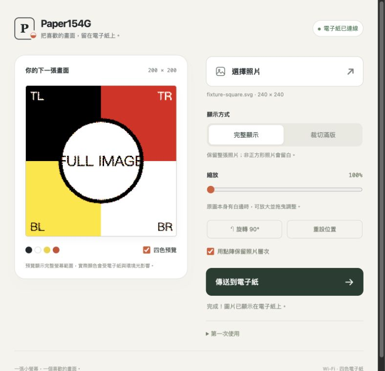

# ePaper Badge — Waveshare 1.54G

iPhone Safari Wi-Fi 傳圖與 BLE 傳圖電子紙徽章。

適用板子：**ESP32-S3-ePaper-1.54G**（200 × 200，黑／白／紅／黃）。
本專案是新製作的韌體，使用 Waveshare 官方螢幕驅動，並實作 Adafruit Bluefruit Connect 的圖片傳輸協定。



## iPhone Safari 傳圖（建議）

1. 保持板子 USB 供電。
2. iPhone「設定 → Wi-Fi」連接 **Paper154G**，使用燒錄前自行設定的 Wi-Fi 密碼。
3. 在 Safari 網址列輸入 **http://192.168.4.1**。這個 Wi-Fi 沒有網際網路；如果手機詢問是否保留連線，請保留。
4. 按「選擇照片」。選「完整顯示」可保留整張圖片；選「裁切滿版」會填滿正方形並裁去超出的部分。也能拖曳、縮放、旋轉。
5. 確認 200 × 200 四色預覽後，按「傳送到電子紙」。等待頁面顯示完成。

圖片在手機瀏覽器內轉成四色，再將 10,000-byte 畫面傳給板子。圖片本身若帶有白邊，可調整縮放去除。螢幕刷新在獨立工作執行緒執行，因此刷新期間網頁仍可回覆狀態。

網頁直接放在 ESP32 中，不依賴外部網站或雲端服務。兩種傳輸方式都保留；同一時間請只用一種方式傳送。

## iPhone BLE 操作（保留）

1. 保持板子接著 USB 供電。
2. 安裝 [Bluefruit Connect](https://apps.apple.com/tw/app/bluefruit-connect/id830125974)，開啟手機藍牙，允許 App 使用藍牙及選取照片。
3. 開啟 App，在裝置列表找到 **Paper154G**，按 **Connect**。從 App 內連線即可。
4. 選 **Image Transfer** → **Choose Image**，選照片並裁切。
5. **Resolution** 選 **Standard → 240 × 240**；韌體會縮放至螢幕的 200 × 200。請用 Standard 保留黃色來源；App 的 E-Ink 模式會先把照片轉成三色。
6. **Bit Depth** 選 **16-bit**，**Transfer Mode** 選 **With Response**。
7. 按 **Send Image**，等傳送完成，再等電子紙刷新完成。畫面閃動是電子紙更新過程的一部分。
8. 下一張圖片重複第 4–7 步。若方向不對，可使用 App 的旋轉按鈕再傳一次。

App 顯示傳送完成代表資料已傳送；電子紙仍需要約 20 秒刷新。刷新後保留最後畫面，下次開機不會自動清除。第一次開機會先顯示操作提示卡。

若 Bluefruit App 選圖畫面正常、按 Done 後卻裁掉上半部，請改用上面的 Safari 傳圖。這是 App 裁切流程的問題，已被裁掉的圖片內容無法由板子補回。

若圖片傳送失敗，先斷開 App 連線、重新 Connect，再傳一次。若出現校驗錯誤，保持 With Response 模式並讓手機靠近板子。板子僅在收齊圖片且校驗通過後才會刷新，不會顯示收到一半的圖片。

## 檔案與編譯

- `firmware/EpaperBLE/`：可用 Arduino IDE 開啟的程式與電子紙驅動。
- `.dev/build/`：本機編譯結果，含 bootloader、partition table、app 和 merged binary。
- `backups/`：這台板子原先 Flash 的完整備份，僅供本機還原，不應公開上傳。
- `tools/test_receiver.cpp`：RGB565／RGB888 解析、任意 BLE 分段、校驗、尺寸限制與四色轉換測試。
- `web/dist/`：板子提供的 Safari 網頁。
- `tools/embed_web.py`：將網頁打包進 `WebAssets.h`；改網頁後先執行此程式再編譯。
- `tools/test_web.mjs`：完整顯示／裁切／旋轉／縮放與四色封裝測試。
- `vendor/`：核對過的官方來源。

編譯使用 Arduino-ESP32 **3.3.12**，板子選 **ESP32S3 Dev Module**，Flash **8 MB**、Partition **8M with spiffs**（`default_8MB`）、PSRAM **OPI**、USB Mode **Hardware CDC and JTAG**、USB CDC On Boot **Enabled**。

macOS／Linux 安裝 Arduino CLI、Python 3、Node.js 與 C++ 編譯器後，可執行：

```sh
sh tools/setup.sh
# 編輯 firmware/EpaperBLE/DeviceSecrets.h，設定自己的 Wi-Fi 密碼。
sh tools/test.sh
sh tools/compile.sh
```

`setup.sh` 會在專案的 `.dev/` 中設定工具鏈與安裝 Arduino-ESP32 3.3.12，不變更全域 Arduino 設定。`compile.sh` 會先重新嵌入網頁，再編譯韌體。也可直接用 Arduino IDE 開啟 `firmware/EpaperBLE/EpaperBLE.ino`，使用上述板子設定編譯。

首次設定會從 `DeviceSecrets.example.h` 建立本機 `DeviceSecrets.h`。請在其中設定 8–63 字元的 Wi-Fi 密碼；空白密碼無法通過編譯。此設定檔已加入 `.gitignore`，公開版本不包含任何裝置密碼。使用 Arduino IDE 時也須先建立此檔案。

公開 repo 包含程式、網頁、測試與文件；`.dev/`（工具鏈／編譯結果／診斷紀錄）及 `backups/`（裝置原始 Flash）僅留在本機，不上傳。

## 原始內容還原

請先確認備份檔及 `backups/manifest.json` 存在。還原會恢復燒錄 BLE 韌體前的程式與設定。

1. 拔 USB，按住 BOOT 再插回，放開 BOOT。
2. 核對備份 SHA-256 與 manifest 一致。
3. 在本專案資料夾執行（序列埠依實際值調整）：

```sh
esptool --port /dev/cu.usbmodem1101 write-flash 0 backups/original-20261030.bin
```

## BLE 協定

使用 Nordic UART Service：

- Service：`6e400001-b5a3-f393-e0a9-e50e24dcca9e`
- RX（手機寫入）：`6e400002-b5a3-f393-e0a9-e50e24dcca9e`
- TX（通知／讀取狀態）：`6e400003-b5a3-f393-e0a9-e50e24dcca9e`

圖片封包：`!I` + bit depth（16 或 24）+ width（uint16 LE）+ height（uint16 LE）+ pixel bytes + checksum。RGB565 為 little endian，RGB888 為 R、G、B。所有 bytes 連同 checksum 的和，取低 8 bits，應為 `0xFF`。

支援 1–512 像素的寬高，自動中央正方形裁切、雙線性縮放至 200 × 200、四色誤差擴散。逾 30 秒沒收到下一段資料會取消未完成圖片；斷線會丟棄未完成的資料。畫面刷新期間請勿再次送圖。

USB 序列埠（115200）可輸入 `STATUS` 查看狀態，`DEMO` 顯示 Wi-Fi／BLE 操作卡，`CLEAR` 清白畫面。每次刷新後至少保留 5 秒間隔。

v2.1 利用電子紙本身的斷電保留特性；Flash 只記錄「已有畫面」，不再反覆寫入完整圖片，避免小型 NVS 分區更新大型圖片時容量不足。開機會保留目前畫面。

## 來源

- [Waveshare 產品與接腳說明](https://docs.waveshare.com/ESP32-S3-ePaper-1.54G)
- [Waveshare 官方程式](https://github.com/waveshareteam/ESP32-S3-ePaper-1.54G)，commit `55eb1278f482c0cfd1e0cba5611a4132022eea48`。驅動保留原授權；本地新增 BUSY 超時偵測。
- [Adafruit Image Transfer 協定](https://learn.adafruit.com/bluefruit-le-connect/image-transfer)
- [Adafruit iOS 原始碼](https://github.com/adafruit/Bluefruit_LE_Connect_v2)，commit `26da88b2a667e1de42e029959f405f40130a10d8`，MIT 授權保留於 `vendor/adafruit/LICENSE`。

編譯與電腦端測試不等於實際 iPhone 傳圖驗證；實機驗證結果記錄於 `VALIDATION.md`。
